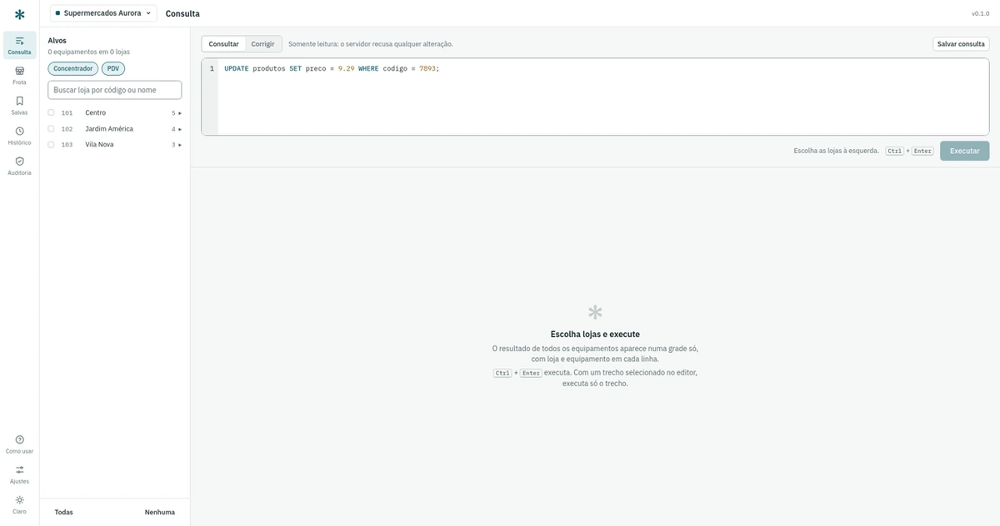
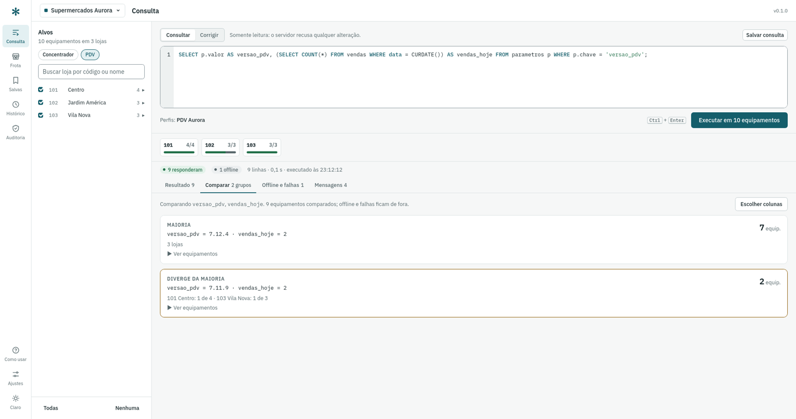
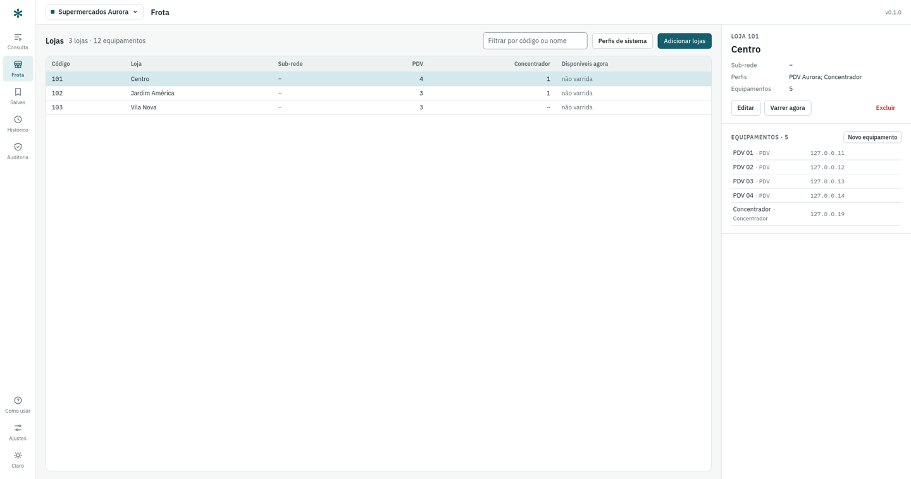
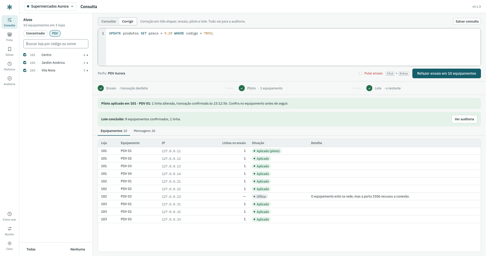
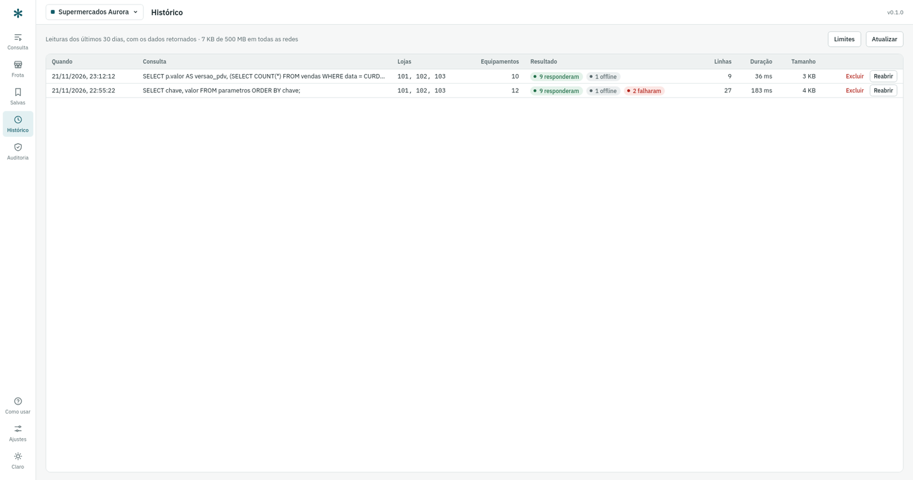
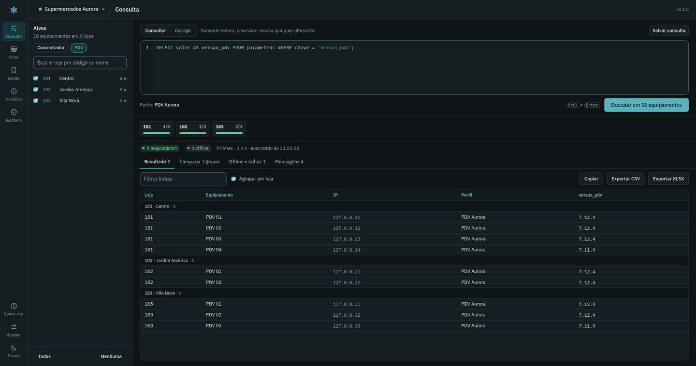

# SelectAll

**One SQL, every store.** A free, open source desktop app for retail IT teams to query and fix, in one go, the databases of every point-of-sale terminal, store hub and store server.

[Português](README.md) · English · [Español](README.es.md)

The app interface is in Brazilian Portuguese; the screenshots below show it.

<p align="center"></p>

## Why it exists

A supermarket chain has dozens of stores and hundreds of checkouts, each with its own database. To find which terminals run the wrong version, or to fix a record on all of them, the options are poor: log into each machine, open a ticket with the POS vendor, or keep home-made scripts.

SelectAll started as one of those scripts. `querymyall`, written in Python in the IT team of a retail chain, did exactly that: build each store's addresses from its subnet, try the user of each POS system, and merge everything into a CSV. It worked, but only for whoever could run it. Then came QueryMass, a SQL client over many connections, which lost what made the script useful: thinking in stores and checkouts, not connections.

SelectAll brings both together. The fleet (chain, store, device) is the center, reading is fast, writing is deliberate, and a terminal that is switched off is treated as what it is: normal.

## What it does

| | |
| --- | --- |
| **Fleet** | Chains, stores, POS terminals, self-checkouts, store hubs and servers. Added by address rule (`10.{sub}.3.1-50`), pasted list, spreadsheet or network scan. |
| **Query** | One `SELECT` on every chosen device, in a read-only transaction. One grid with store, device, IP and profile on each row. CSV and XLSX export. |
| **Compare** | Groups devices by identical result and points out the ones that differ from the majority. |
| **Fix** | Rehearsal (runs and rolls back everywhere), pilot (applies on one device) and rollout (applies on the rest). Blocks `UPDATE` without `WHERE` and schema changes. Every step goes to the audit log. |
| **Library** | Saved queries with parameters (`{{product_code}}`), shareable with the team. |
| **History** | Every read kept with each device's data, to reopen, compare and retry failures. |

Works with **MySQL/MariaDB, PostgreSQL and SQL Server** through native drivers, with no database client to install.



## Screens

<table>
  <tr>
    <td width="50%"><br><sub><b>Fleet.</b> Stores and devices per chain, with system profiles.</sub></td>
    <td width="50%"><br><sub><b>Fix.</b> Rehearsal, pilot and rollout, one transaction per device.</sub></td>
  </tr>
  <tr>
    <td width="50%"><br><sub><b>History.</b> Every read kept with its data, to reopen and compare.</sub></td>
    <td width="50%"><br><sub><b>Dark theme.</b> Light, dark or following the system.</sub></td>
  </tr>
</table>

## In one minute

1. Create the chain and, under Frota (fleet), a system profile: engine, port, user. The password goes to the operating system's credential store.
2. Add the stores by pasting IPs or by address rule.
3. Under Consulta (query), tick the stores, write the SQL and press `Ctrl+Enter`.

The full walkthrough, in Portuguese, is in the [user guide](docs/guia.md) and inside the app under Como usar.

## Download

From the [releases page](https://github.com/lucaswotta/selectall/releases):

| System | File | Install |
| --- | --- | --- |
| Windows 10 and 11 | `SelectAll_<version>_x64-setup.exe` | Run it; installs for the current user, no administrator rights |
| Debian, Ubuntu | `SelectAll_<version>_amd64.deb` | `sudo apt install ./SelectAll_<version>_amd64.deb` |
| Other Linux | `SelectAll_<version>_amd64.AppImage` | `chmod +x` and run |

Each release ships `SHA256SUMS.txt`. Installers are not code-signed; Windows may ask for confirmation on first run. Linux needs WebKitGTK 4.1 (Debian 12, Ubuntu 22.04 or newer) and a Secret Service keyring (GNOME Keyring or KWallet).

## Security

- Passwords live only in the operating system's credential store (Credential Manager on Windows, Secret Service on Linux), never in files, spreadsheets or exports.
- Reads run in a `READ ONLY` transaction on MySQL and PostgreSQL; on SQL Server, the SQL is analyzed and the transaction is always rolled back.
- Parameters enter as quoted text in each engine's dialect, never raw.
- Append-only local audit log with SQL, values, stores and each device's result.
- Recommended: a database user with `SELECT` only in the read profile.

## Settings and limits

- **Ajustes (settings):** devices of the same store running at once (default 4; at most 16 overall) and history limits (30 days or 500 MB).
- **Data:** `selectall.db` in `%APPDATA%\io.github.lucaswotta.selectall` on Windows and `~/.local/share/io.github.lucaswotta.selectall` on Linux.
- **Limits:** up to 1,000 rows and 4 MB per device; 30 s per query and 3 s to connect; SQL Server 2008/2012 without updates (TLS 1.0 only) is not supported.
- **Not in this release:** multi-user server, scheduling, Oracle, interface in other languages and macOS.

## Development

Stable Rust, Node.js 20+ and, on Linux, `libwebkit2gtk-4.1-dev librsvg2-dev libxdo-dev libssl-dev libdbus-1-dev pkg-config`. On Windows, MSVC and NASM. Docker only for tests against real databases.

```sh
cd app && npm ci && npx tauri dev
```

CI checks: `cargo fmt --all --check`, `cargo clippy --workspace --all-targets -- -D warnings`, `cargo test --workspace`, `npm run check` in `app/` and `sh scripts/test-{mysql,postgres,sqlserver}.sh`, which start throwaway databases with random passwords. `npx tauri build` writes installers to `target/release/bundle/`; a `v*` tag publishes the release with notes from the [CHANGELOG](CHANGELOG.md).

## License

MIT or Apache-2.0, at your option. See [`LICENSE-MIT`](LICENSE-MIT) and [`LICENSE-APACHE`](LICENSE-APACHE).
