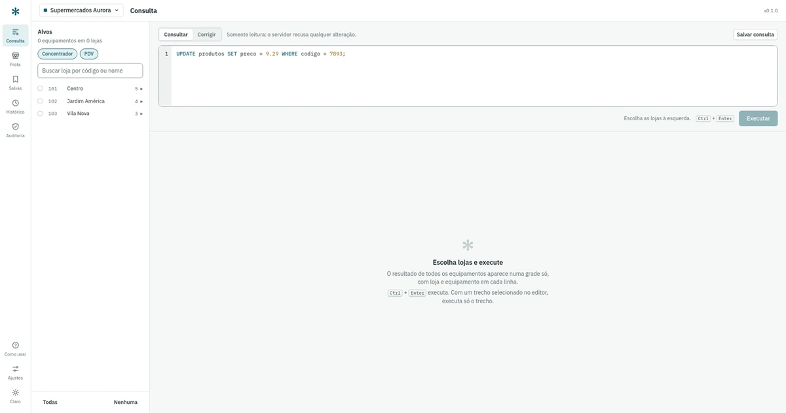
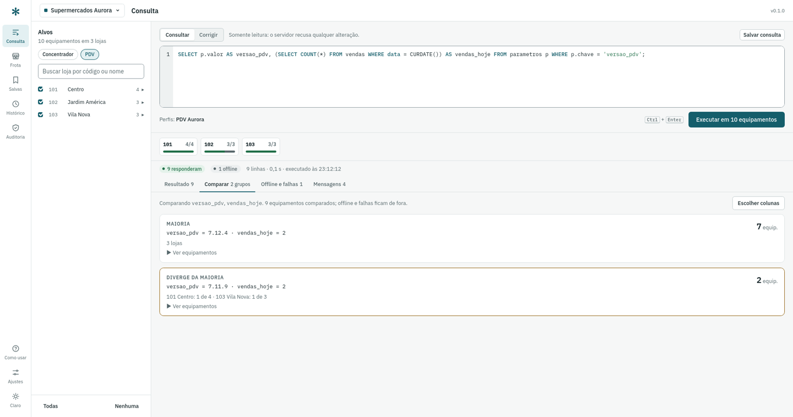
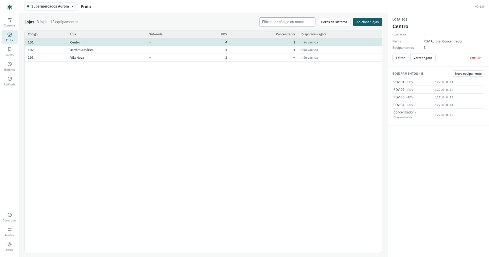
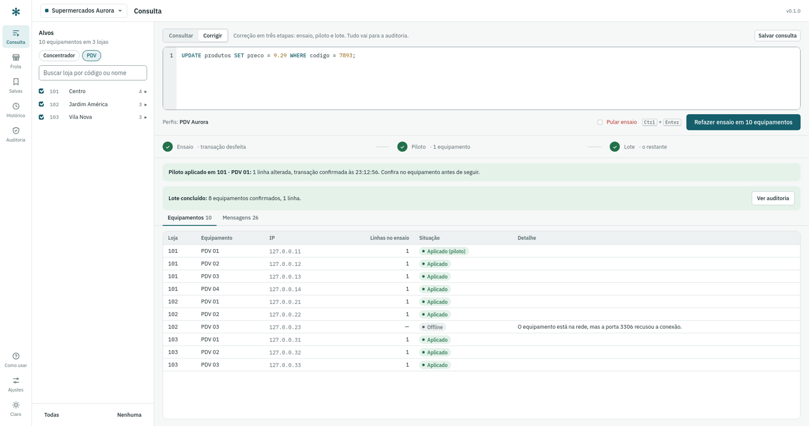
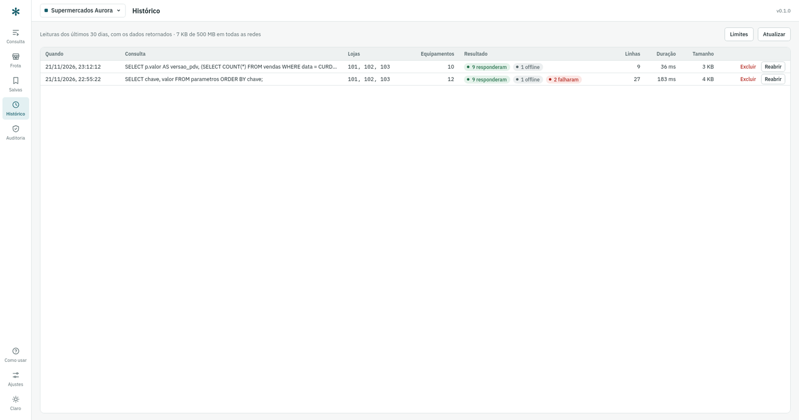
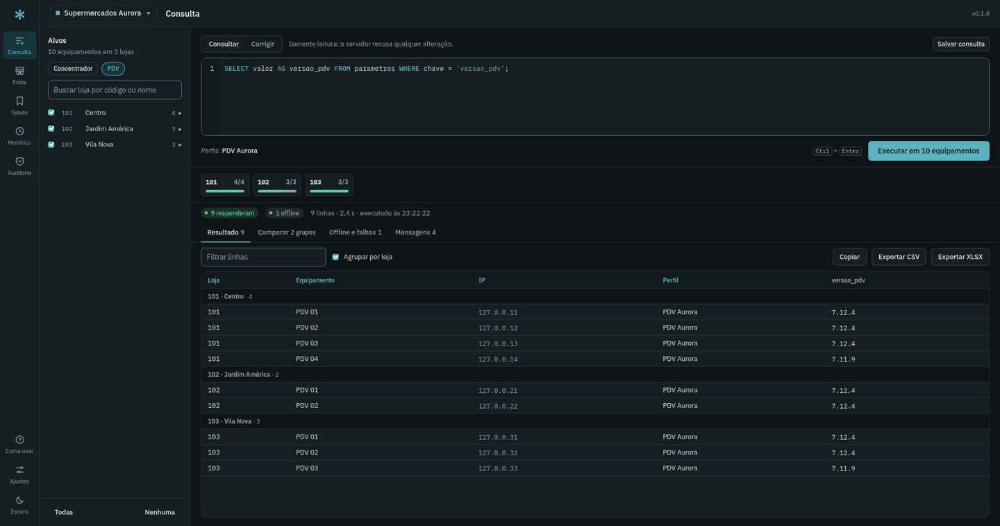

# SelectAll

**Un SQL, todas las tiendas.** Aplicación de escritorio gratuita y de código abierto para que el área de TI del retail consulte y corrija, de una sola vez, las bases de datos de todos los puntos de venta, concentradores y servidores de las tiendas.

[Português](README.md) · [English](README.en.md) · Español

La interfaz de la aplicación está en portugués de Brasil; las capturas la muestran así.

<p align="center"></p>

## Por qué existe

Una cadena de supermercados tiene decenas de tiendas y cientos de cajas, cada una con su propia base de datos. Para saber qué cajas tienen la versión equivocada, o para corregir un registro en todas, las opciones son malas: entrar máquina por máquina, abrir un ticket con el proveedor del punto de venta o mantener scripts caseros.

SelectAll empezó como uno de esos scripts. `querymyall`, escrito en Python en el área de TI de una cadena minorista, hacía justamente eso: armar las direcciones de cada tienda a partir de su subred, probar el usuario de cada sistema de punto de venta y juntar todo en un CSV. Funcionaba, pero solo para quien sabía ejecutarlo. Después vino QueryMass, un cliente SQL sobre muchas conexiones, que perdió lo que daba valor al script: pensar en tiendas y cajas, no en conexiones.

SelectAll reúne las dos cosas. La flota (cadena, tienda, equipo) es el centro, leer es rápido, escribir es deliberado, y una caja apagada se trata como lo que es: algo normal.

## Qué hace

| | |
| --- | --- |
| **Flota** | Cadenas, tiendas, cajas, autoservicios, concentradores y servidores. Alta por regla de direcciones (`10.{sub}.3.1-50`), lista pegada, planilla o escaneo de red. |
| **Consulta** | Un `SELECT` en todos los equipos elegidos, en transacción de solo lectura. Una grilla con tienda, equipo, IP y perfil en cada fila. Exporta CSV y XLSX. |
| **Comparación** | Agrupa los equipos por resultado idéntico y señala los que difieren de la mayoría. |
| **Corrección** | Ensayo (ejecuta y deshace en todos), piloto (aplica en uno) y lote (aplica en el resto). Bloquea `UPDATE` sin `WHERE` y cambios de estructura. Cada etapa va a la auditoría. |
| **Biblioteca** | Consultas guardadas con parámetros (`{{codigo_producto}}`), para compartir con el equipo. |
| **Historial** | Cada lectura guardada con los datos de cada equipo, para reabrir, comparar y repetir las fallas. |

Funciona con **MySQL/MariaDB, PostgreSQL y SQL Server** mediante drivers nativos, sin instalar clientes de base de datos.



## Pantallas

<table>
  <tr>
    <td width="50%"><br><sub><b>Flota.</b> Tiendas y equipos por cadena, con perfiles de sistema.</sub></td>
    <td width="50%"><br><sub><b>Corrección.</b> Ensayo, piloto y lote, una transacción por equipo.</sub></td>
  </tr>
  <tr>
    <td width="50%"><br><sub><b>Historial.</b> Cada lectura guardada con sus datos, para reabrir y comparar.</sub></td>
    <td width="50%"><br><sub><b>Tema oscuro.</b> Claro, oscuro o según el sistema.</sub></td>
  </tr>
</table>

## En un minuto

1. Cree la cadena y, en Frota (flota), un perfil de sistema: motor, puerto, usuario. La contraseña va al almacén de credenciales del sistema operativo.
2. Agregue las tiendas pegando las IP o por regla de direcciones.
3. En Consulta, marque las tiendas, escriba el SQL y presione `Ctrl+Enter`.

La guía completa, en portugués, está en la [guía de uso](docs/guia.md) y dentro de la aplicación, en Como usar.

## Descarga

En la [página de versiones](https://github.com/lucaswotta/selectall/releases):

| Sistema | Archivo | Instalación |
| --- | --- | --- |
| Windows 10 y 11 | `SelectAll_<versión>_x64-setup.exe` | Ejecutar; instala para el usuario actual, sin pedir administrador |
| Debian, Ubuntu | `SelectAll_<versión>_amd64.deb` | `sudo apt install ./SelectAll_<versión>_amd64.deb` |
| Otros Linux | `SelectAll_<versión>_amd64.AppImage` | `chmod +x` y ejecutar |

Cada versión incluye `SHA256SUMS.txt`. Los instaladores no están firmados; Windows puede pedir confirmación en la primera ejecución. En Linux se necesita WebKitGTK 4.1 (Debian 12, Ubuntu 22.04 o más nuevos) y un almacén Secret Service (GNOME Keyring o KWallet).

## Seguridad

- Contraseñas solo en el almacén de credenciales del sistema (Administrador de credenciales en Windows, Secret Service en Linux), nunca en archivos, planillas ni exportaciones.
- Lectura en transacción `READ ONLY` en MySQL y PostgreSQL; en SQL Server, análisis del SQL y transacción siempre deshecha.
- Los parámetros entran como texto entre comillas en el dialecto de cada motor, nunca en crudo.
- Auditoría local que solo admite agregados, con SQL, valores, tiendas y el resultado de cada equipo.
- Recomendado: en el perfil de lectura, un usuario de base de datos solo con `SELECT`.

## Configuración y límites

- **Ajustes:** equipos de una misma tienda ejecutando a la vez (4 por defecto; hasta 16 en total) y límites del historial (30 días o 500 MB).
- **Datos:** `selectall.db` en `%APPDATA%\io.github.lucaswotta.selectall` en Windows y `~/.local/share/io.github.lucaswotta.selectall` en Linux.
- **Límites:** hasta 1.000 filas y 4 MB por equipo; 30 s por consulta y 3 s para conectar; SQL Server 2008/2012 sin actualizar (solo TLS 1.0) no es compatible.
- **Fuera de esta versión:** servidor multiusuario, programación de tareas, Oracle, interfaz en otros idiomas y macOS.

## Desarrollo

Rust estable, Node.js 20+ y, en Linux, `libwebkit2gtk-4.1-dev librsvg2-dev libxdo-dev libssl-dev libdbus-1-dev pkg-config`. En Windows, MSVC y NASM. Docker solo para las pruebas contra bases reales.

```sh
cd app && npm ci && npx tauri dev
```

Verificaciones de la CI: `cargo fmt --all --check`, `cargo clippy --workspace --all-targets -- -D warnings`, `cargo test --workspace`, `npm run check` en `app/` y `sh scripts/test-{mysql,postgres,sqlserver}.sh`, que levantan bases descartables con contraseñas aleatorias. `npx tauri build` genera los instaladores en `target/release/bundle/`; un tag `v*` publica la versión con las notas del [CHANGELOG](CHANGELOG.md).

## Licencia

MIT o Apache-2.0, a su elección. Vea [`LICENSE-MIT`](LICENSE-MIT) y [`LICENSE-APACHE`](LICENSE-APACHE).
