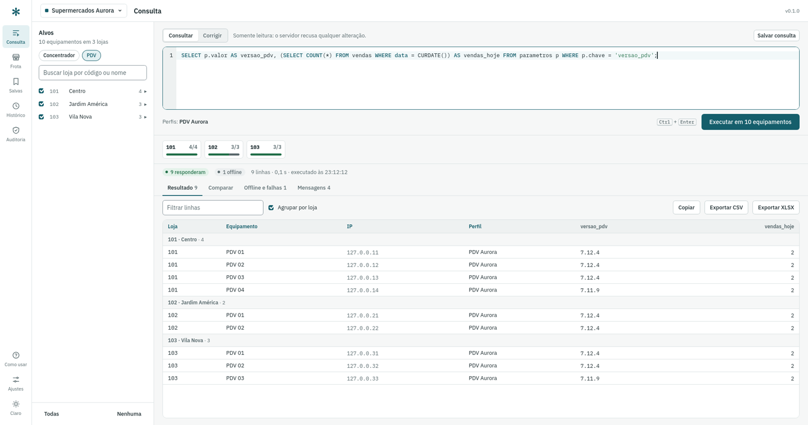

# SelectAll

Aplicativo desktop gratuito e de código aberto para equipes de TI de varejo consultarem e corrigirem, com um único SQL, os bancos de todos os PDVs, concentradores e servidores das suas lojas.



## O que faz

- Cadastra a frota por rede: lojas, equipamentos e perfis de sistema (motor, porta, banco, usuário). Lojas entram por regra de endereçamento, lista colada, planilha CSV/XLSX ou varredura de faixa.
- Roda um `SELECT` em todos os equipamentos escolhidos, em transação somente leitura, e junta o resultado numa grade com loja, equipamento, IP e perfil em cada linha. Exporta em CSV e XLSX.
- Compara os resultados e aponta os equipamentos que divergem da maioria.
- Corrige em três etapas: ensaio (transação desfeita), piloto em um equipamento e lote no restante, com auditoria local só de acréscimo.
- Guarda consultas com parâmetros (`{{codigo_produto}}`) e o histórico das leituras com os dados de cada equipamento.
- Motores: MySQL/MariaDB, PostgreSQL e SQL Server, com drivers nativos em Rust.

O guia de uso está em [`docs/guia.md`](docs/guia.md) e também dentro do aplicativo, em Como usar.

## Requisitos

- Windows 10 ou 11 (64 bits), ou Linux de 64 bits com WebKitGTK 4.1 (Debian 12, Ubuntu 22.04 ou mais novos).
- Acesso de rede do computador às portas dos bancos das lojas.
- Linux: um cofre Secret Service ativo (GNOME Keyring ou KWallet) para guardar senhas.

## Instalação

Baixe o instalador da [página de versões](https://github.com/lucaswotta/selectall/releases):

| Sistema | Arquivo | Como instalar |
| --- | --- | --- |
| Windows | `SelectAll_<versão>_x64-setup.exe` | Executar; instala para o usuário atual, sem pedir administrador |
| Debian, Ubuntu | `SelectAll_<versão>_amd64.deb` | `sudo apt install ./SelectAll_<versão>_amd64.deb` |
| Outros Linux | `SelectAll_<versão>_amd64.AppImage` | `chmod +x` e executar |

Cada versão traz `SHA256SUMS.txt` para conferir o download. Os instaladores não são assinados digitalmente: o Windows SmartScreen pode pedir confirmação na primeira execução.

## Uso

1. Crie a rede (a empresa cujas lojas você atende).
2. Em Frota, cadastre um perfil de sistema e adicione as lojas.
3. Em Consulta, marque as lojas, escreva o SQL e execute com `Ctrl+Enter`. Um trecho selecionado no editor executa sozinho.
4. Para alterar dados, use o modo Corrigir: ensaio, piloto e lote.

Detalhes, atalhos e mensagens de erro comuns no [guia](docs/guia.md).

## Configuração

- Ajustes (barra lateral): equipamentos da mesma loja executando ao mesmo tempo (padrão 4; no total, até 16) e limites do histórico (padrão 30 dias ou 500 MB).
- Frota e configurações ficam em `selectall.db`, na pasta de dados do aplicativo: `%APPDATA%\io.github.lucaswotta.selectall` no Windows e `~/.local/share/io.github.lucaswotta.selectall` no Linux.
- Senhas ficam só no cofre do sistema: Gerenciador de Credenciais no Windows e Secret Service no Linux. Exportações de frota e de consultas não levam senhas.
- Recomendado: no perfil de leitura, um usuário de banco só com `SELECT`; um usuário com escrita só é necessário para corrigir.

## Limitações

- Até 1.000 linhas e 4 MB por equipamento em cada resultado; prazo de 30 segundos por consulta e 3 segundos para conectar.
- SQL Server sem transação somente leitura no servidor: a leitura depende da análise do SQL e de uma transação sempre desfeita.
- SQL Server 2008 e 2012 sem atualização só oferecem TLS 1.0, que não é aceito.
- Comandos que mudam estrutura (`ALTER`, `DROP`, `CREATE`, `TRUNCATE`) são recusados no modo Corrigir.
- Uso individual: sem servidor, sem agendamento, sem Oracle nem SQLite como alvo, interface só em português, sem instalador para macOS.

## Desenvolvimento

Requisitos: Rust estável, Node.js 20 ou mais novo e, no Linux, `libwebkit2gtk-4.1-dev`, `librsvg2-dev`, `libxdo-dev`, `libssl-dev`, `libdbus-1-dev` e `pkg-config`. No Windows, ferramentas de compilação do Visual Studio (MSVC) e NASM. Docker só para os testes contra bancos reais.

```sh
cd app
npm ci
npx tauri dev
```

Verificações exigidas pela CI:

```sh
cargo fmt --all --check
cargo clippy --workspace --all-targets -- -D warnings
cargo test --workspace
(cd app && npm run check)
sh scripts/test-mysql.sh
sh scripts/test-postgres.sh
sh scripts/test-sqlserver.sh
```

Cada `scripts/test-<motor>.sh` sobe um servidor descartável (`mysql:8.4`, `postgres:17`, `mcr.microsoft.com/mssql/server:2022-latest`), cria um usuário só de leitura e outro de escrita, com senhas aleatórias, e roda os testes de integração.

Instaladores locais: `cd app && npx tauri build` gera `.deb` e AppImage no Linux e o instalador NSIS no Windows em `target/release/bundle/`. Um tag `v*` no GitHub publica os três como pre-release, com as notas do `CHANGELOG.md`.

| Caminho | Conteúdo |
| --- | --- |
| `crates/core` | `selectall-core`: frota, SQLite, cofre e execução de SQL, sem interface |
| `app/src-tauri` | Comandos Tauri sobre o núcleo |
| `app/src` | Interface em Svelte 5 e TypeScript |
| `design` | Tokens de cor e tipografia, marca e protótipo |
| `docs` | Definição do produto e guia de uso |

No código, a rede de varejo é `Chain`, a loja é `Store`, o equipamento é `Device` e o perfil de sistema é `Profile`. Textos para a pessoa ficam em português.

## Licença

MIT ou Apache-2.0, à sua escolha. Veja `LICENSE-MIT` e `LICENSE-APACHE`.
