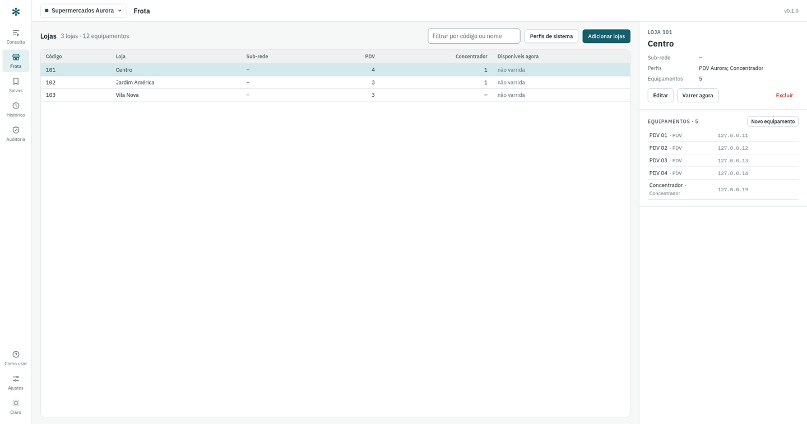
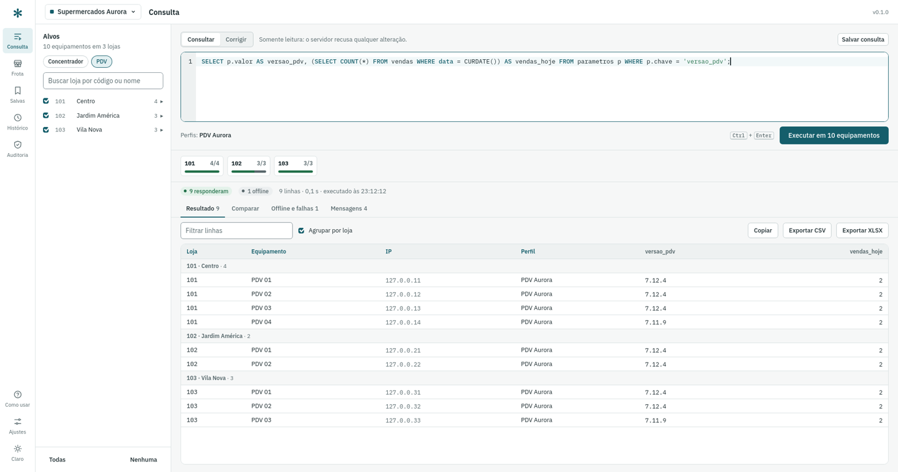
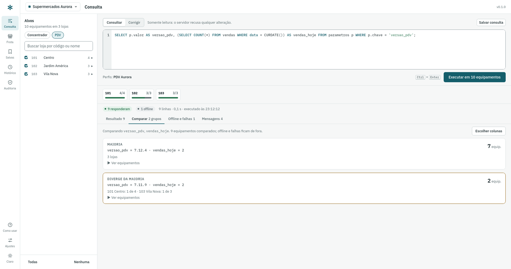
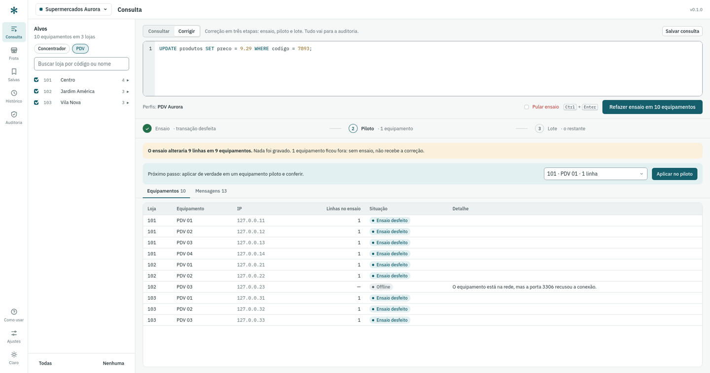
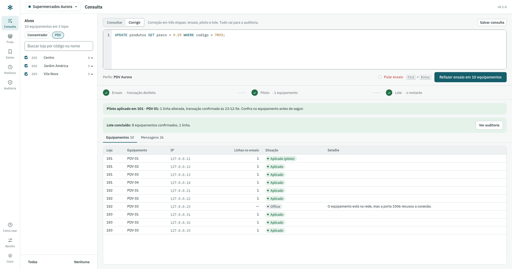
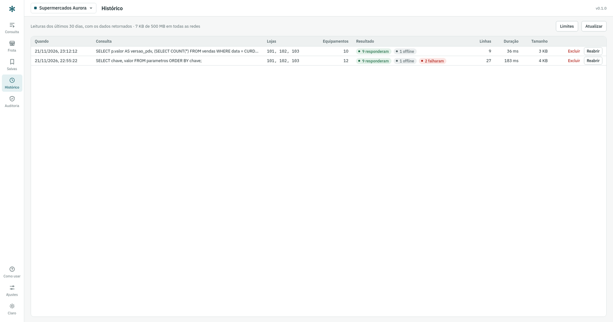

# Guia de uso

Do cadastro da frota à primeira correção. O mesmo conteúdo, resumido, está no aplicativo em Como usar. As telas abaixo usam uma rede fictícia.

## 1. Rede, perfil e lojas

Na primeira abertura, crie a rede: a empresa cujas lojas você atende. O seletor no alto da tela troca, renomeia, exclui ou cria outras redes; cada uma tem suas próprias lojas, perfis, consultas e histórico.

Em Frota, abra **Perfis de sistema** e cadastre como o aplicativo entra no banco dos PDVs: nome, motor (MySQL/MariaDB, PostgreSQL ou SQL Server), porta, banco, usuário e senha. A senha vai para o cofre do sistema operacional. Para só consultar, use um usuário com `SELECT` apenas; o usuário com escrita só é necessário para corrigir.

Depois, **Adicionar lojas**, por um destes caminhos:

| Caminho | Quando usar |
| --- | --- |
| Regra de rede | Os equipamentos seguem um padrão de endereço, como `10.{sub}.3.1-50` para PDV e `10.{sub}.3.200` para concentrador. Informe as lojas com a sub-rede de cada uma. |
| Colar lista | IPs soltos, faixas (`10.20.3.1-12`) ou linhas `loja;ip;tipo;nome`. Escolha o perfil das linhas que não dizem qual. |
| Planilha | CSV ou XLSX com colunas como loja, nome, sub-rede, ip, equipamento, tipo e perfil. Senhas não são lidas de planilhas. |
| Varredura | Testa a porta numa faixa e mostra quem responde, com a versão do servidor. |

Tudo passa por uma prévia, com linhas novas, repetidas e com erro, antes de entrar na frota.

## 2. Consultar

1. Em Consulta, marque as lojas na coluna Alvos. Nada vem marcado ao abrir. A seta ao lado de cada loja lista os equipamentos para desmarcar um a um, e os botões de tipo (PDV, Concentrador) escondem um tipo inteiro.
2. Escreva o SQL. Com um trecho selecionado, só ele é executado.
3. Execute com o botão ou `Ctrl+Enter`.

A leitura roda em transação somente leitura: o servidor recusa qualquer alteração. Cada loja mostra o progresso, e a grade junta o resultado de todos os equipamentos, com loja, equipamento, IP e perfil em cada linha.

Na grade: filtro, ordenação por coluna, agrupamento por loja, cópia e exportação em CSV ou XLSX para a pasta Downloads.

**Comparar** agrupa os equipamentos por resultado idêntico e mostra quem diverge da maioria, com quantos equipamentos de cada loja estão em cada grupo. Colunas de data e hora ficam fora da comparação por padrão.

**Offline e falhas** lista quem não respondeu, com o motivo em português, e o botão **Repetir só estes**, que mantém o resultado de quem já respondeu.

## 3. Corrigir

No modo Corrigir, uma alteração passa por três etapas:

1. **Ensaio:** roda em transação em todos os alvos e desfaz. Mostra quantas linhas cada equipamento alteraria e destaca quem foge do padrão.
2. **Piloto:** aplica de verdade em um equipamento escolhido. Confira nele antes de seguir.
3. **Lote:** aplica no restante, uma transação por equipamento. Para confirmar, digite o número de equipamentos. Falhas são desfeitas e podem ser repetidas.

São recusados `UPDATE` e `DELETE` sem `WHERE` que cite uma coluna e comandos que mudam estrutura (`ALTER`, `DROP`, `CREATE`, `TRUNCATE`). **Pular ensaio** fica desligado por padrão e pede confirmação; sem ensaio não há prévia de linhas.

Cada etapa vai para a **Auditoria**, com quando, SQL, valores dos parâmetros, lojas alcançadas e o resultado de cada equipamento. A tela mostra a rede aberta; **Todas as redes** inclui as outras. O registro só aceita acréscimo e é exportado em CSV ou XLSX.

## 4. Consultas salvas e parâmetros

**Salvar consulta** guarda o SQL na biblioteca da rede, com nome, descrição e perfil opcional. Um parâmetro como `{{codigo_produto}}` vira um campo pedido antes de executar. O valor entra sempre como texto citado no dialeto de cada motor; parâmetro em comentário ou em nome de tabela é recusado. Consultas de escrita abrem no modo Corrigir.

Em Salvas, **Exportar** grava a biblioteca em JSON na pasta Downloads, para compartilhar com a equipe. **Importar** liga o perfil pelo nome e substitui consultas com o mesmo nome.

## 5. Histórico

Cada leitura fica no Histórico com SQL, valores, lojas, status e os dados de cada equipamento. **Reabrir** volta à mesma grade, com comparação, exportação e repetição das falhas.

SQL ou valor que cite senha, token ou segredo não é guardado; a execução fica só com os dados.

## 6. Ajustes

| Ajuste | Padrão | Para quê |
| --- | --- | --- |
| Equipamentos da mesma loja ao mesmo tempo | 4 | Não saturar o link da loja. No total, até 16 equipamentos rodam juntos. |
| Guardar histórico por até | 30 dias | Ao passar, saem as execuções mais antigas; a mais recente sempre fica. |
| Espaço máximo do histórico | 500 MB | Idem. |

O tema alterna entre automático, claro e escuro pelo último botão da barra lateral.

## Atalhos

| Tecla | Ação |
| --- | --- |
| `Ctrl+Enter` | Executar, ou fazer o ensaio no modo Corrigir |
| `Ctrl+F` | Buscar no editor |
| `Tab` | Indentar no editor |
| `Esc`, depois `Tab` | Sair do editor pelo teclado |
| `Esc` | Fechar a janela aberta |
| `Enter` ou `Espaço` | Escolher a loja na tabela da Frota |
| `Shift+Enter` num botão de tipo | Mostrar só aquele tipo |

## Mensagens comuns

| Mensagem | O que fazer |
| --- | --- |
| Offline: a porta recusou a conexão ou não respondeu | Comum fora do horário da loja. Repita mais tarde com Repetir só estes. |
| Usuário ou senha recusados | Confira o perfil em Frota. Perfil sem senha guardada aparece com aviso na Consulta. |
| Prazo esgotado | A consulta passou de 30 segundos no equipamento. Restrinja o SQL. |
| Falha ao negociar TLS com o servidor | SQL Server 2008 e 2012 sem atualização só oferecem TLS 1.0. Atualize o servidor ou habilite TLS 1.2. |
| Resultado desconhecido | A conexão caiu depois do COMMIT. Confira no equipamento se a alteração foi gravada antes de repetir. |
